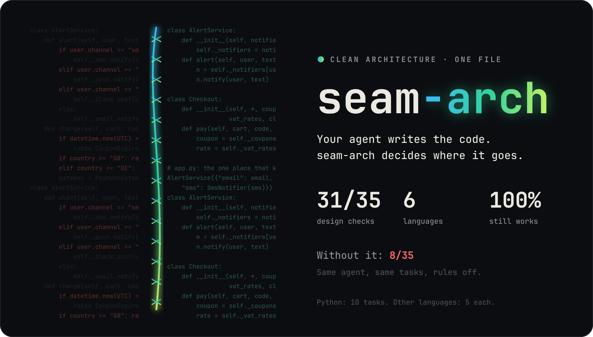
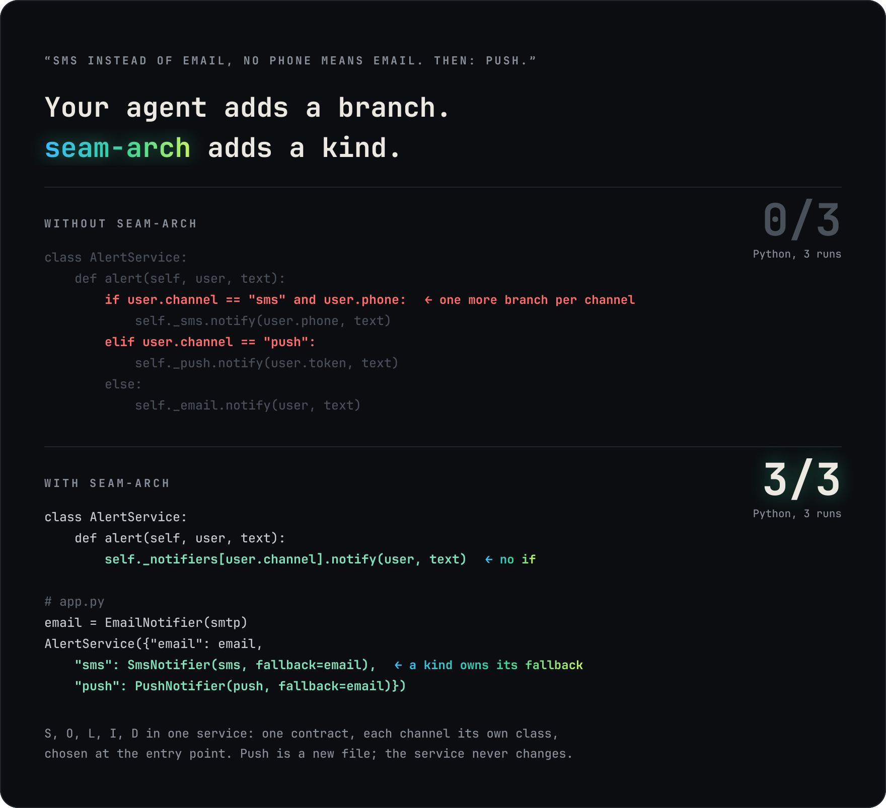
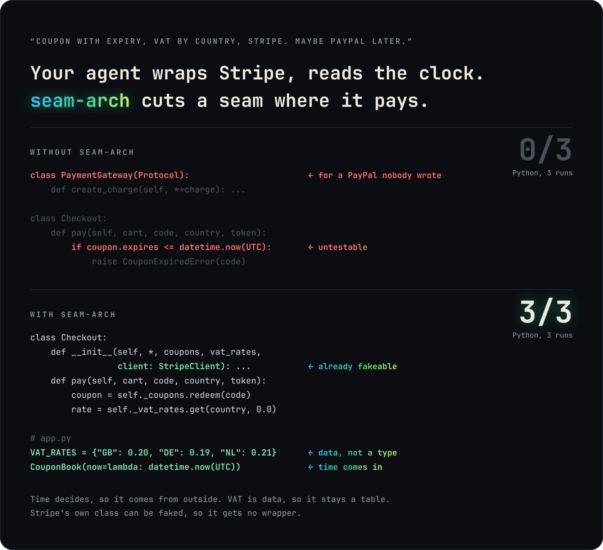
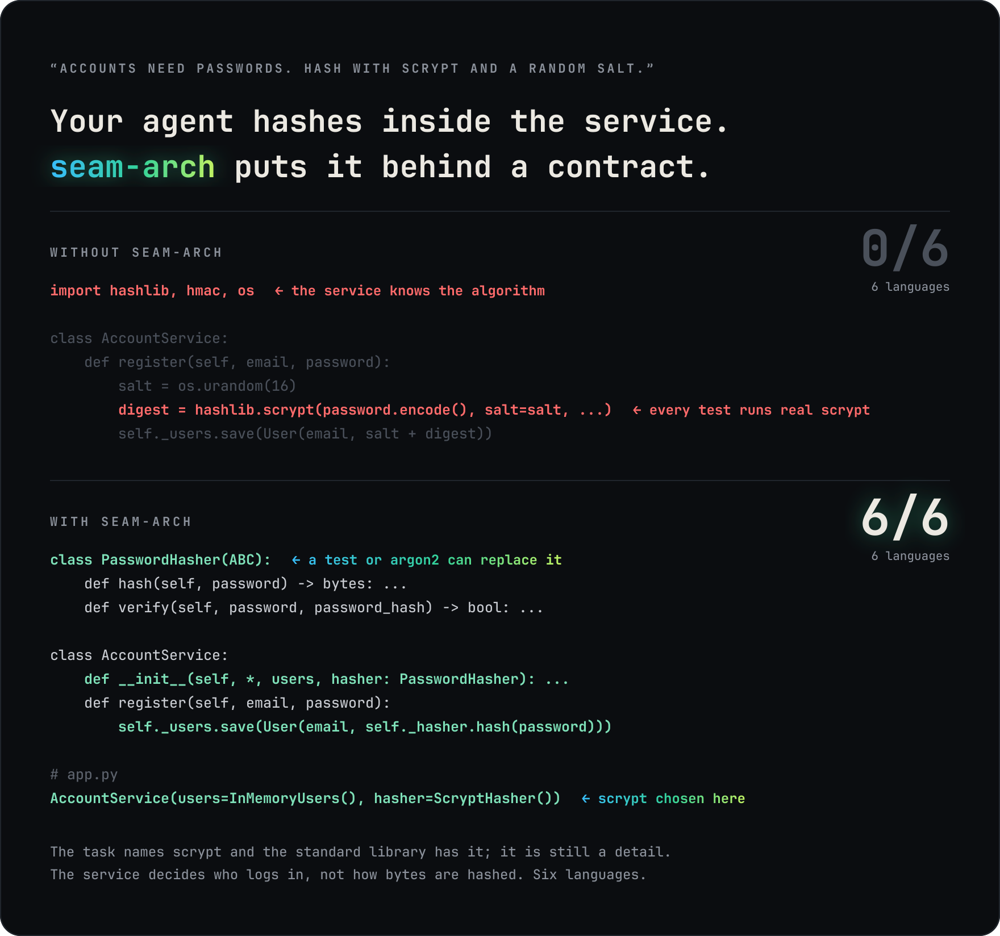

<p align="center">
  
</p>

<p align="center">
  <em>He decides where code goes, and nothing lands in the wrong place.</em>
</p>

<p align="center">
  
  
  
  
</p>

<p align="center">
  <a href="#examples">Examples</a> &middot;
  <a href="#numbers">Numbers</a> &middot;
  <a href="#install">Install</a> &middot;
  <a href="#tasks">Tasks</a> &middot;
  <a href="#sources">Sources</a>
</p>

<p align="center">
  <sub><strong>English</strong> &middot; <a href="i18n/README.ru.md">Русский</a> &middot; <a href="i18n/README.es.md">Español</a> &middot; <a href="i18n/README.ko.md">한국어</a> &middot; <a href="i18n/README.zh-CN.md">简体中文</a> &middot; <a href="i18n/README.ja.md">日本語</a></sub>
</p>

---

**seam-arch** is one `AGENTS.md` that teaches a coding agent architecture: where code goes and how its parts depend on each other. One question drives it: *done another way, would the program decide anything differently?* If not, it is a detail, and it reaches business logic only through a type a test can replace.

> [!NOTE]
> Built on Robert C. Martin's *Clean Architecture*: the Dependency Rule, SOLID, Humble Object, plain data across boundaries. Every rule earned its line on a task agents fail without it.

## Examples

Real output from the benchmark, trimmed. The picture is the preview; open a language below it to see the code the agent wrote there.

### 1. Alerts: SOLID in one service

**"Users may choose SMS instead of email; no phone means email. Then: push."** Python, three runs: without AGENTS.md 0/3, with it 3/3.

<p align="center">
  
</p>

<details>
<summary><strong>Python</strong></summary>

```python
class Notifier(Protocol):
    def notify(self, user: User, text: str) -> None: ...

class AlertService:
    def __init__(self, notifiers: Mapping[Channel, Notifier]) -> None:
        self._notifiers = notifiers
    def alert(self, user, text):
        self._notifiers[user.channel].notify(user, text)

# app.py
return AlertService({"email": EmailNotifier(smtp), "sms": SmsNotifier(sms)})
```
</details>

<details>
<summary><strong>TypeScript</strong></summary>

```ts
export interface Notifier {
  notify(user: User, text: string): void;
}

export class AlertService {
  constructor(private readonly notifiers: Readonly<Record<Channel, Notifier>>) {}
  alert(user: User, text: string): void {
    this.notifiers[user.channel].notify(user, text);
  }
}

// app.ts
return new AlertService({ email: new EmailNotifier(smtp), sms: new SmsNotifier(sms) });
```
</details>

<details>
<summary><strong>Go</strong></summary>

```go
type Notifier interface {
	Notify(user User, text string) error
}

func (s *AlertService) Alert(user User, text string) error {
	n, ok := s.notifiers[user.Channel]
	if !ok {
		return fmt.Errorf("%w: %q", ErrUnknownChannel, user.Channel)
	}
	return n.Notify(user, text)
}

// app.go
return NewAlertService(map[string]Notifier{"email": email, "sms": NewSmsNotifier(sms)})
```
</details>

<details>
<summary><strong>Java</strong></summary>

```java
public interface Notifier {
    void deliver(User user, String text);
}

public AlertService(Map<Channel, Notifier> notifiers) { this.notifiers = Map.copyOf(notifiers); }

public void alert(User user, String text) {
    notifiers.get(user.channel()).deliver(user, text);
}

// App.java
return new AlertService(Map.of(Channel.EMAIL, new EmailNotifier(smtp), Channel.SMS, new SmsNotifier(sms)));
```
</details>

<details>
<summary><strong>C#</strong></summary>

```csharp
public interface INotifier
{
    void Notify(User user, string text);
}

public sealed class AlertService(IReadOnlyDictionary<Channel, INotifier> notifiers)
{
    public void Alert(User user, string text) => notifiers[user.Channel].Notify(user, text);
}

// App.cs
new Dictionary<Channel, INotifier> { [Channel.Email] = new EmailNotifier(smtp), [Channel.Sms] = new SmsNotifier(sms) }
```
</details>

<details>
<summary><strong>Rust</strong></summary>

```rust
pub trait Notifier {
    fn notify(&self, user: &User, text: &str) -> Result<(), NotifyError>;
}

pub struct AlertService {
    notifiers: HashMap<Channel, Rc<dyn Notifier>>,
}

// app.rs
notifiers.insert(Channel::Email, Rc::new(EmailNotifier::new(smtp)));
notifiers.insert(Channel::Sms, Rc::new(SmsNotifier::new(sms)));
AlertService::new(notifiers)
```
</details>

### 2. Checkout: a seam only where it is needed

**"Coupon with expiry, VAT by country, charge through Stripe. Maybe PayPal later."** Python, three runs: without AGENTS.md 0/3, with it 3/3. The hardest task: in the other languages the agent still wraps Stripe in four of five.

<p align="center">
  
</p>

<details>
<summary><strong>Python</strong></summary>

```python
class Checkout:
    def __init__(self, *, coupons: CouponBook, vat_rates: Mapping[str, float], client: StripeClient) -> None:
        self._coupons = coupons
        self._vat_rates = vat_rates
        self._client = client

    def pay(self, cart: Cart, code: str, country: str, card_token: str) -> str:
        coupon = self._coupons.redeem(code)          # refuses an expired coupon, on the injected clock
        discounted = cart.total * (100 - coupon.percent) / 100
        total = discounted * (1 + self._vat_rates.get(country, 0.0))
        return self._client.create_charge(amount_cents=round(total * 100), currency="eur", source=card_token)

# app.py
VAT_RATES = {"GB": 0.20, "DE": 0.19, "NL": 0.21}

def build_checkout(client: StripeClient) -> Checkout:
    coupons = CouponBook(now=lambda: datetime.now(UTC))
    return Checkout(coupons=coupons, vat_rates=VAT_RATES, client=client)
```
</details>

<details>
<summary><strong>TypeScript</strong></summary>

```ts
export function amountDue(totalCents: number, couponPercent: number, country: string): number {
  const discounted = Math.round((totalCents * (100 - couponPercent)) / 100);
  return discounted + Math.round((discounted * (VAT_PERCENT[country] ?? 0)) / 100);
}

export class Checkout {
  constructor(
    private readonly coupons: CouponBook,
    private readonly client: StripeClient,
    private readonly now: () => Date,
  ) {}
  async pay(cart: Cart, code: string, country: string, cardToken: string): Promise<string> {
    const coupon = redeem(this.coupons, code, this.now());
    const amountCents = amountDue(Math.round(cart.total * 100), coupon.percent, country);
    return this.client.createCharge({ amountCents, currency: "EUR", source: cardToken });
  }
}

// app.ts
return new Checkout(new CouponBook(), client, () => new Date());
```
</details>

<details>
<summary><strong>Go</strong></summary>

```go
type Checkout struct {
	Coupons    *CouponBook
	Charger    Charger // StripeClient is one
	VATPercent map[string]int64
	Now        func() time.Time
}

func (c *Checkout) Pay(ctx context.Context, cart Cart, code, country, cardToken string) (string, error) {
	total := cart.TotalCents
	if code != "" {
		percent, err := c.Coupons.Redeem(code, c.Now())
		if err != nil {
			return "", err
		}
		total -= total * percent / 100
	}
	total += (total*c.VATPercent[country] + 50) / 100
	return c.Charger.CreateCharge(ctx, total, "EUR", cardToken)
}

// app.go
return &Checkout{Coupons: NewCouponBook(), Charger: client,
	VATPercent: map[string]int64{"GB": 20, "DE": 19, "NL": 21}, Now: time.Now}
```
</details>

<details>
<summary><strong>Java</strong></summary>

```java
public Checkout(CouponBook coupons, VatRates vat, StripeClient client, Clock clock) { ... }

public String pay(Cart cart, String code, String country, String cardToken) {
    Coupon coupon = coupons.find(code);
    if (!clock.instant().isBefore(coupon.expires())) {
        throw new CouponExpiredException(code);
    }
    long cents = priceInCents(cart.total(), coupon.percent(), vat.rateFor(country));
    return client.createCharge(cents, "eur", cardToken);
}

// App.java
VatRates vat = new VatRates(Map.of("GB", new BigDecimal("0.20"), "DE", new BigDecimal("0.19"), "NL", new BigDecimal("0.21")));
return new Checkout(new CouponBook(), vat, client, Clock.systemUTC());
```
</details>

<details>
<summary><strong>C#</strong></summary>

```csharp
public sealed class Checkout(
    CouponBook coupons,
    IReadOnlyDictionary<string, decimal> vatRates,
    StripeClient client,
    Func<DateTimeOffset> now)
{
    public string Pay(Cart cart, string code, string country, string cardToken)
    {
        var coupon = coupons.Find(code);
        if (coupon.Expires < now()) throw new CouponExpiredException(code);
        var vat = vatRates.GetValueOrDefault(country, 0m);
        return client.CreateCharge(Cents(cart.Total, coupon.Percent, vat), "eur", cardToken);
    }
}

// App.cs
new Checkout(new CouponBook(), VatRates, client, () => DateTimeOffset.UtcNow);
```
</details>

<details>
<summary><strong>Rust</strong></summary>

```rust
pub struct Checkout {
    pub coupons: CouponBook,
    client: Box<dyn StripeClient>,
    now: Box<dyn Fn() -> SystemTime>,
}

impl Checkout {
    pub fn pay(&self, cart: &Cart, code: &str, country: &str, card_token: &str) -> Result<String, CheckoutError> {
        let coupon = self.coupons.redeem(code, (self.now)())?;
        let amount = price_cents(cart.total_cents, coupon.percent, vat_percent(country));
        Ok(self.client.create_charge(amount, "EUR", card_token))
    }
}

// vat.rs
pub fn vat_percent(country: &str) -> u64 {
    match country { "GB" => 20, "DE" => 19, "NL" => 21, _ => 0 }
}

// app.rs
Checkout::new(client, Box::new(SystemTime::now))
```
</details>

Time decides, so it comes in from outside. VAT is data, so it stays a table. Stripe's class can already be faked, so it gets no wrapper.

### 3. Passwords: a detail behind a contract

**"Accounts need passwords. Hash with scrypt and a random salt."** Without AGENTS.md 0/6 languages, with it 6/6.

<p align="center">
  
</p>

<details>
<summary><strong>Python</strong></summary>

```python
class PasswordHasher(ABC):
    @abstractmethod
    def hash(self, password: str) -> bytes: ...
    @abstractmethod
    def verify(self, password: str, password_hash: bytes) -> bool: ...

class AccountService:
    def __init__(self, *, users: UserStore, hasher: PasswordHasher) -> None:
        self._users = users
        self._hasher = hasher

    def log_in(self, email: str, password: str) -> bool:
        user = self._users.find(email)
        if user is None or not user.password_hash:
            return False
        return self._hasher.verify(password, user.password_hash)

# app.py
return AccountService(users=InMemoryUsers(), hasher=ScryptHasher())
```
</details>

<details>
<summary><strong>TypeScript</strong></summary>

```ts
export interface PasswordHasher {
  hash(password: string): string;
  verify(password: string, hash: string): boolean;
}

export class AccountService {
  constructor(
    private readonly users: UserStore,
    private readonly hasher: PasswordHasher,
  ) {}
  logIn(email: string, password: string): boolean {
    const user = this.users.find(email);
    return user !== undefined && this.hasher.verify(password, user.passwordHash);
  }
}

// app.ts
return new AccountService(new InMemoryUsers(), new ScryptHasher());
```
</details>

<details>
<summary><strong>Go</strong></summary>

```go
type PasswordHasher interface {
	Hash(password string) ([]byte, error)
	Matches(hash []byte, password string) bool
}

func NewAccountService(users UserStore, hasher PasswordHasher) *AccountService {
	return &AccountService{users: users, hasher: hasher}
}

func (s *AccountService) LogIn(email, password string) (bool, error) {
	user, ok := s.users.Find(email)
	if !ok {
		return false, nil
	}
	return s.hasher.Matches(user.PasswordHash, password), nil
}

// app.go
return NewAccountService(NewInMemoryUsers(), PBKDF2Hasher{})
```
</details>

<details>
<summary><strong>Java</strong></summary>

```java
public interface PasswordHasher {
    byte[] hash(String password);
    boolean matches(String password, byte[] stored);
}

public AccountService(UserStore users, PasswordHasher hasher) {
    this.users = users;
    this.hasher = hasher;
}

public boolean logIn(String email, String password) {
    return users.find(email)
            .filter(user -> user.passwordHash().length > 0)
            .map(user -> hasher.matches(password, user.passwordHash()))
            .orElse(false);
}

// App.java
return new AccountService(new InMemoryUsers(), new Pbkdf2PasswordHasher());
```
</details>

<details>
<summary><strong>C#</strong></summary>

```csharp
public interface IPasswordHasher
{
    byte[] Hash(string password);
    bool Verify(string password, byte[] stored);
}

public sealed class AccountService(IUserStore users, IPasswordHasher hasher)
{
    public bool LogIn(string email, string password) =>
        users.Find(email) is { } user && hasher.Verify(password, user.PasswordHash);
}

// App.cs
public static AccountService BuildService() => new(new InMemoryUsers(), new Pbkdf2PasswordHasher());
```
</details>

<details>
<summary><strong>Rust</strong></summary>

```rust
pub trait PasswordHasher {
    fn new_salt(&self) -> Vec<u8>;
    fn derive(&self, password: &str, salt: &[u8]) -> Vec<u8>;
}

pub struct AccountService {
    users: Box<dyn UserStore>,
    hasher: Box<dyn PasswordHasher>,
}

// app.rs
AccountService::new(Box::new(InMemoryUsers::default()), Box::new(KdfHasher))
```
</details>

The service decides who logs in; how the bytes are hashed is a detail, even when the task names it and the standard library has it.

## Numbers

The same agent with and without AGENTS.md.

| language | design tasks | without AGENTS.md | with AGENTS.md |
|---|:-:|:-:|:-:|
| Python | 10 | 2/10 | **10/10** |
| TypeScript | 5 | 1/5 | **4/5** |
| Go | 5 | 1/5 | **4/5** |
| Java | 5 | 2/5 | **4/5** |
| C# | 5 | 1/5 | **5/5** |
| Rust | 5 | 1/5 | **4/5** |

Every language has the same ten tasks; outside Python five of them are measured so far. `speculative-abstraction` is the counterweight: it fails if the rules over-design. Every behaviour check passes in both arms: seam-arch changes where code goes, not whether it works.

## Install

`AGENTS.md` is the only file. Keep one copy and link it wherever your agents read their rules:

```bash
curl -fsSL --create-dirs -o ~/seam-arch/AGENTS.md https://raw.githubusercontent.com/eugeneliukindev/seam-arch/main/AGENTS.md

mkdir -p ~/.claude/rules && ln -s ~/seam-arch/AGENTS.md ~/.claude/rules/seam-arch.md   # Claude Code
ln -s ~/seam-arch/AGENTS.md ~/.codex/AGENTS.md                                       # Codex
ln -s ~/seam-arch/AGENTS.md ~/.gemini/GEMINI.md                                      # Gemini CLI
ln -s ~/seam-arch/AGENTS.md ~/.config/opencode/AGENTS.md                             # opencode
ln -s ~/seam-arch/AGENTS.md ./AGENTS.md          # one project: Cursor, Copilot, Zed and any agent that reads AGENTS.md
```

Run the same `curl` again to update every agent at once.

## Tasks

Each task is an ordinary ticket in a small repository; a hidden check the agent never sees looks at the design. A number is how many languages passed; ✗ and ✓ are Python, where the other languages are not measured yet.

| task | what the agent is asked | what the hidden check looks for | without AGENTS.md | with AGENTS.md |
|---|---|---|:-:|:-:|
| `heavy-decision` | summarize a resume: read the file, grade it | DIP: the file reader comes in as a parameter | 0/6 | 6/6 |
| `notify-channel` | users may choose SMS instead of email | OCP: a new channel is a new class, not a branch | 1/6 | 6/6 |
| `password-login` | add login, hash with scrypt | DIP: hashing behind a contract, not in the service | 0/6 | 6/6 |
| `combo-checkout` | coupon with expiry, VAT by country, charge through Stripe | a seam only where needed: time from outside, VAT as data, no wrapper for Stripe | 1/6 | 2/6 |
| `combo-alerts` | SMS with an email fallback, then push in a second session | SOLID: no branch on the channel, one-method contract, every notifier honours it | ✗ | ✓ |
| `coupon-expiry` | refuse expired coupons | DIP: the clock comes from outside | ✗ | ✓ |
| `humble-cli` | add --overdue to a CLI | Humble Object: the CLI only parses and prints | ✗ | ✓ |
| `plain-records` | umbrella advice from a forecast API | boundary: the raw payload becomes a record at the edge | ✗ | ✓ |
| `second-channel` | SMS, then push in a second session | OCP after two edits | ✗ | ✓ |
| `speculative-abstraction` | charge through Stripe, "maybe PayPal later" | the counterweight: no interface for the one client | 6/6 | 6/6 |

## Sources

- Robert C. Martin, [The Clean Architecture](https://blog.cleancoder.com/uncle-bob/2012/08/13/the-clean-architecture.html) and *Clean Architecture*: the Dependency Rule, SOLID, Humble Object, boundaries.
- Michael Feathers, *Working Effectively with Legacy Code*: seams.
- Miško Hevery, [Guide: Writing Testable Code](https://github.com/mhevery/guide-to-testable-code): ask for collaborators, never fetch them.
- Robert C. Martin, *Clean Code*: flag arguments, wrapping third-party APIs.
- [Google style guides](https://google.github.io/styleguide/cppguide.html#Parting_Words): follow the code around you.
- Alexis King, [Parse, don't validate](https://lexi-lambda.github.io/blog/2019/11/05/parse-don-t-validate/): validate at the boundary.

## License

[MIT](LICENSE).
